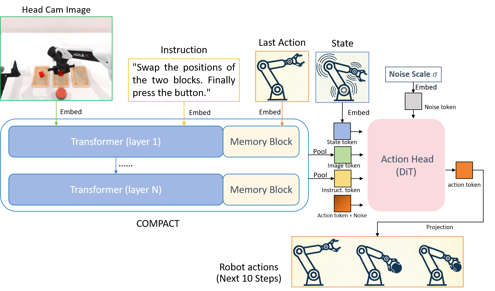

<h1 align="center">RMBench: Memory-Dependent Manipulation Benchmark</h1>

RMBench: Memory-Dependent Robotic Manipulation Benchmark with Insights into Policy Design. <i>Under Review</i>, [PDF](https://arxiv.org/pdf/2603.01229) | [arXiv](https://arxiv.org/abs/2603.01229) | [Website](https://rmbench.github.io/) | [Join our Community 🔥](https://robotwin-platform.github.io/doc/community/index.html)

> Tianxing Chen*, Yuran Wang*, Mingleyang Li*, Yan Qin*, Hao Shi, Zixuan Li, Yifan Hu, Yingsheng Zhang, Kaixuan Wang, Yue Chen, Hongcheng Wang, Renjing Xu, Ruihai Wu, Yao Mu, Yaodong Yang, Hao Dong†, Ping Luo†

This working copy keeps the upstream RMBench/RoboTwin 2.0 codebase and adds a fully
reproducible **COMPACT** pipeline for it: memory-side modules grafted onto the Mem-0
execution module, trained on converted RMBench demonstrations, warm-started from the
officially released Mem-0 weights, and evaluated both open-loop (dataset replay) and
closed-loop (SAPIEN simulation).

# 📰 Updates

**2026.07.14** — Since the previously trained Mem-0 checkpoints were not backed up before our development machine was recycled, we have re-organized the training and now publicly release the retrained model weights:

- **M(1) tasks**: due to limited computational resources, all M1 tasks were trained jointly into a single multi-task `m1_mix` model. The complete model, the processed `m1_mix` dataset, training/inference configs, and all evaluation logs and videos are available at [qiuly/Mem-0-m1mix-RMBench](https://huggingface.co/qiuly/Mem-0-m1mix-RMBench) and [qiuly/Mem-0-m1mix-dataset-RMBench](https://huggingface.co/datasets/qiuly/Mem-0-m1mix-dataset-RMBench).
- **M(n) tasks**: per-task execution-module checkpoints for `battery_try`, `blocks_ranking_try`, `cover_blocks` and `press_button`, together with per-task normalization stats and evaluation results, are available at [qiuly/Mem-0-mn-RMBench](https://huggingface.co/qiuly/Mem-0-mn-RMBench).

**Local additions in this copy**

- `policy/Mem0-Compact/` — COMPACT side memory replacing Mem-0's `MemoryBank`, with the
  same DiT flow-matching action head (see [policy/Mem0-Compact/COMPACT_for_VLA.png](./policy/Mem0-Compact/COMPACT_for_VLA.png)).
  Supports **warm-start from the released Mem-0 checkpoints** (Qwen-only transfer) and
  M(1)/M(n) + no-memory baseline variants.
- `script/open_loop_eval_compact.py`, `script/open_loop_eval_mem0.py` — teacher-forced
  open-loop evaluation for the COMPACT policies and for the official Mem-0 policy.
- `lerobot_environment.yml`, `rmbench_environment.yml` — pinned, exportable environments.
- `setup_server_envs.sh` — one-shot environment bootstrap for a fresh server.

# 🧭 Pipeline at a glance

| Stage | What runs | Environment | Entry point |
|---|---|---|---|
| 1. Assets & raw demos | scene assets, `demo_clean` HDF5 | — | `script/_download_assets.sh`, `script/_download_data.sh` |
| 2. Data preparation | HDF5 → LeRobot v3.0 + norm stats | `lerobot` | `policy/Mem0-Compact/scripts/convert_all.sh` |
| 3. Training | COMPACT / baseline, TBPTT | `lerobot` | `policy/Mem0-Compact/source/training/train_ddp.sh` |
| 4. Open-loop eval | teacher-forced replay, no simulator | `lerobot` (COMPACT) / `RMBench` (Mem-0) | `script/open_loop_eval_compact.py`, `script/open_loop_eval_mem0.py` |
| 5. Closed-loop eval | SAPIEN rollouts, success rate | `RMBench` (+ `vllm` for M(n)) | `script/eval_policy.py` |

# 💻 Hardware and disk

- **Closed-loop eval / open-loop eval**: 1 GPU, ~12–15 GB for simulation + a 2B VLM
  (~7–10 GB for the execution module alone). Rendering also needs a working EGL/Vulkan
  driver.
- **Training**: the reference recipe uses 8×A800 (80 GB) with DDP; a single ≥24 GB GPU
  works for single-task runs with `BATCH_SIZE=1` and gradient checkpointing.
- **Disk**: raw `demo_clean` is ~3 GB/task (`demo_clean_200` adds ~13 GB for the four
  tasks that ship it); converted LeRobot datasets are ~20 MB–750 MB per task;
  full training checkpoints are ~15 GB each (model + optimizer + scheduler).

# 1. Installation

## 1.1 Clone

```bash
git clone https://github.com/RoboTwin-Platform/RMBench.git
cd RMBench
```

Three conda environments are used because their dependency pins conflict:

| Env | Purpose | Key pins |
|---|---|---|
| `RMBench` | simulation, closed-loop eval, Mem-0 inference | torch 2.4.1+cu121, sapien 3.0.0b1, transformers 4.57.6 |
| `lerobot` | HDF5→LeRobot conversion, COMPACT training, COMPACT open-loop eval | torch 2.10+cu128, lerobot 0.4.4, transformers 4.57.6, ffmpeg |
| `vllm` | M(n) remote planner (Qwen3-VL-8B) | vllm |

`setup_server_envs.sh` builds all of them non-interactively
(`bash setup_server_envs.sh --rmbench`, `--compact`, `--vllm`, or `--all`). The manual
recipes below are the debugged versions and are what to fall back to.

## 1.2 `RMBench` — simulation + evaluation

```bash
conda create -n RMBench python=3.10 -y
conda activate RMBench

pip install torch==2.4.1 torchvision --index-url https://download.pytorch.org/whl/cu121

# base simulator deps (use _install.sh if you do not need the mirror)
bash script/_install_tsinghuayuan.sh
```

If `pytorch3d` or `curobo` fails to build inside `_install_tsinghuayuan.sh`, install
them by hand:

```bash
git clone --branch stable https://github.com/facebookresearch/pytorch3d.git /tmp/pytorch3d
cd /tmp/pytorch3d
pip install -e . --no-build-isolation
cd -

git clone --branch v0.7.8 --depth 1 https://github.com/NVlabs/curobo.git
cd curobo
pip install -e . --no-build-isolation
cd ..
```

Then add the VLM inference stack that Mem-0 / Mem0-Compact deployment needs:

```bash
python -m pip install \
    "transformers==4.57.6" \
    accelerate \
    qwen-vl-utils \
    "hydra-core==1.1.1" \
    "omegaconf==2.1.2" \
    pandas \
    pyarrow \
    av

pip install setuptools==69.5.1
python -m pip install ninja einops "h5py==3.16.0" diffusers rich
pip install "flash-attn==2.6.1" --no-build-isolation
python -m pip install --force-reinstall "setuptools<81"
```

`transformers==4.57.6` is **required**: `Qwen3VLModel` does not exist in 4.53.x and
earlier, so a stale version fails at model construction.

## 1.3 `lerobot` — data conversion + training

The pinned environment is exported in [lerobot_environment.yml](./lerobot_environment.yml):

```bash
# the file carries a machine-specific `prefix:` line — drop it before creating
grep -v '^prefix:' lerobot_environment.yml > /tmp/lerobot_env.yml
conda env create -f /tmp/lerobot_env.yml
```

Condensed manual recipe (equivalent; pick the CUDA wheel tag that matches your driver):

```bash
conda create -y -n lerobot python=3.10
conda activate lerobot

conda install ffmpeg -c conda-forge      # required: many LeRobot samples fail without it
pip install torch torchvision torchaudio --index-url https://download.pytorch.org/whl/cu128
pip install "transformers==4.57.6" "lerobot==0.4.4"

pip install omegaconf hydra-core
pip install "lerobot[aloha]" "lerobot[metaworld]" "lerobot[feetech]" "lerobot[smolvla]"
```

> Check the version: `python -c "import transformers; print(transformers.__version__)"`
> must print `4.57.6`. `pip install lerobot` alone can pull an older `transformers`
> that lacks Qwen3-VL.

Every shell that touches this env must export the conda `libstdc++` path, otherwise
PIL/`datasets`/`lerobot` raise
`ImportError: /lib/x86_64-linux-gnu/libstdc++.so.6: version 'GLIBCXX_3.4.29' not found`:

```bash
export LD_LIBRARY_PATH="$CONDA_PREFIX/lib:${LD_LIBRARY_PATH:-}"
```

## 1.4 `vllm` — M(n) planning module (optional)

Only needed for M(n) tasks, where a high-level planner produces the next subtask
instruction. M(1) tasks never call it.

```bash
conda create -n vllm python=3.10 -y
conda activate vllm
pip install vllm
```

```bash
export CUDA_VISIBLE_DEVICES=0,1,2,3
vllm serve /path/to/Qwen3-VL-8B-Instruct \
  --tensor-parallel-size 4 \
  --mm-encoder-tp-mode data \
  --async-scheduling \
  --media-io-kwargs '{"video": {"num_frames": -1}}' \
  --host 0.0.0.0 --port 8123
```

The port must match `--vllm_url` passed to `script/eval_policy.py`.

## 1.5 Environment gotchas (all seen in practice)

| Symptom | Fix |
|---|---|
| `GLIBCXX_3.4.29 not found` on `import PIL`/`lerobot`/`transformers` | `export LD_LIBRARY_PATH=$CONDA_PREFIX/lib:$LD_LIBRARY_PATH` |
| `cannot import name 'Qwen3VLModel'` | `pip install transformers==4.57.6` |
| Dataset streaming raises `Invalid HF token` / hangs | `export HF_HUB_OFFLINE=1` once the model is cached, or `HF_ENDPOINT=https://hf-mirror.com` |
| Hugging Face downloads hang behind a local socks proxy | `unset ALL_PROXY all_proxy` |
| `conda env create -f lerobot_environment.yml` tries to install into the wrong path | remove the `prefix:` line first |
| `NameError: name 'LOG' ...`/`pkg_resources` errors after installing packages | `pip install --force-reinstall "setuptools<81"`, and `setuptools==69.5.1` before building flash-attn |
| flash-attn builds for hours or fails | build with `--no-build-isolation` after `ninja` is installed; Mem0-Compact runs with SDPA and does **not** require flash-attn |

# 2. Assets, data, and weights

## 2.1 Scene assets

```bash
bash script/_download_assets.sh      # downloads assets/, then patches the asset path
```

The script ends by running `python ./script/update_embodiment_config_path.py`, which
rewrites the absolute asset path in the embodiment configs — re-run it whenever the
repository moves. If you hit a Hugging Face rate limit, `huggingface-cli login` first.

## 2.2 Raw demonstrations

```bash
bash script/_download_data.sh        # -> data/<task>/demo_clean/...
```

Layout per task:

```
data/<task_name>/
├── demo_clean/
│   ├── data/episode0.hdf5 …       # raw trajectories
│   ├── instructions/episode0.json # {"seen": [...], "unseen": [...]}
│   ├── scene_info.json, seed.txt, language_annotation.json
│   └── video/, _traj_data/
└── demo_clean_200/                # only: put_back_block, swap_blocks, cover_blocks, place_block_mat
```

RMBench always evaluates with `demo_clean` + `instruction_type: unseen`.

<details>
<summary>If you need to collect data yourself (we recommend downloading it directly)</summary>

Running the following command first searches for a random seed for the target
collection quantity, then replays that seed to collect data. Please follow the
[RoboTwin 2.0 Doc - Collect Data](https://robotwin-platform.github.io/doc/usage/collect-data.html).

```bash
bash collect_data.sh ${task_name} ${task_config} ${gpu_id}
# Example: bash collect_data.sh cover_blocks demo_clean 0
```
</details>

## 2.3 Model weights

| Weight | Where | Used by |
|---|---|---|
| `Qwen/Qwen3-VL-2B-Instruct` | `policy/Mem-0/checkpoints/Qwen3-VL-2B-Instruct` | all execution modules (backbone is overwritten by the checkpoint) |
| `Qwen/Qwen3-VL-8B-Instruct` | any local dir | M(n) planner (served by vLLM) |
| Released Mem-0 `m1_mix` | [qiuly/Mem-0-m1mix-RMBench](https://huggingface.co/qiuly/Mem-0-m1mix-RMBench) → `policy/Mem0-Compact/checkpoints/released/m1mix/` | Mem-0 closed-loop eval + **COMPACT warm start** |
| Released Mem-0 M(n) | [qiuly/Mem-0-mn-RMBench](https://huggingface.co/qiuly/Mem-0-mn-RMBench) → `policy/Mem0-Compact/checkpoints/released/mn/` | Mem-0 closed-loop eval |

```bash
huggingface-cli download Qwen/Qwen3-VL-2B-Instruct \
    --local-dir policy/Mem-0/checkpoints/Qwen3-VL-2B-Instruct
```

The `m1_mix` checkpoint is uploaded as 9 byte-split parts (a 15.3 GB file):

```bash
cd policy/Mem0-Compact/checkpoints/released/m1mix/checkpoint
cat m1_mix_final_step50000.pt.part?? > m1_mix_final_step50000.pt
sha256sum -c m1_mix_final_step50000.pt.sha256     # expect: OK
```

The M(n) release ships one unsplit `final_step30000.pt` per task
(`battery_try`, `blocks_ranking_try`, `cover_blocks`, `press_button`), each with its
own `norm_stats.json`. Each release directory also contains `configs/` (training +
deployment YAML), `task_instructions.json` (verbatim `--global_task` strings) and
`eval_results/`.

# 3. Data preparation: HDF5 → LeRobot v3.0

All conversion and training happens inside `policy/Mem0-Compact/` and writes into
`lerobot_datasets/` and `assets/`, both of which are rsync targets for the GPU server.

```bash
conda activate lerobot
export LD_LIBRARY_PATH="$CONDA_PREFIX/lib:${LD_LIBRARY_PATH:-}"
cd policy/Mem0-Compact
```

## 3.1 Convert everything (12 tasks)

```bash
bash scripts/convert_all.sh
```

- M(1) tasks (`M1_dataset_to_lerobot.py`): `observe_and_pickup`, `put_back_block`,
  `rearrange_blocks`, `swap_blocks`, `swap_T`
- M(n) tasks (`Mn_dataset_to_lerobot.py`, adds subtask + `subtask_end` labels):
  `battery_try`, `blocks_ranking_try`, `cover_blocks`, `press_button`,
  `place_block_mat`, `classify_blocks`, `storage_blocks`
- For the four tasks that ship `demo_clean_200`, the 200 extra trajectories are
  **appended into the same dataset** (`episode_id` offset by 50 → 250 episodes total),
  and the norm stats cover all of them.

Knobs: `EPISODES=50` (base episodes), `EPISODES_200=200`, `SKIP_200=1` (skip the
append phase), `APPEND_ONLY=1` (datasets already converted, only append).

## 3.2 Convert a single task

```bash
python scripts/hdf5_to_lerobot/M1_dataset_to_lerobot.py --task swap_blocks --episodes 50
python scripts/hdf5_to_lerobot/Mn_dataset_to_lerobot.py --task cover_blocks --episodes 50

# append the demo_clean_200 split manually (same offsets convert_all.sh uses)
python scripts/hdf5_to_lerobot/M1_dataset_to_lerobot.py --task swap_blocks \
    --episodes 200 --demo-root demo_clean_200 --episode-id-offset 50 --append
```

## 3.3 Normalization statistics

State and action are min-max normalized to `[-1, 1]`; the 12 arm joints and the two
grippers share one statistics file per task.

```bash
python scripts/gen_norm_stats.py --task swap_blocks   # -> assets/swap_blocks/norm_stats.json
```

`convert_all.sh` already does this per task. `assets/<task>/global_instruction.txt`
holds the default instruction used at deployment.

## 3.4 Joint M(1) dataset (`m1mix`)

`TASK=m1mix` combines the five existing M(1) directories **virtually** (no copy): the
loader preserves each task's own instruction, assigns globally unique episode IDs and
computes shared statistics into `assets/m1mix/norm_stats.json`.
Requires the five directories `observe_and_pickup`, `put_back_block`,
`rearrange_blocks`, `swap_blocks`, `swap_T` to exist.

## 3.5 Move the prepared data to the training server

```bash
rsync -a --info=progress2 policy/Mem0-Compact/lerobot_datasets/ \
    user@server:/path/to/RMBench/policy/Mem0-Compact/lerobot_datasets/
rsync -a --info=progress2 policy/Mem0-Compact/assets/ \
    user@server:/path/to/RMBench/policy/Mem0-Compact/assets/
```

## 3.6 Sanity check

```bash
du -sh lerobot_datasets/*/ | sort -k2
python - <<'PY'
from lerobot.datasets.lerobot_dataset import LeRobotDataset
ds = LeRobotDataset("swap_blocks", root="lerobot_datasets/swap_blocks")
print(len(ds), ds.meta.total_episodes, ds.meta.total_frames)
PY
```

# 4. Training Mem0-Compact

## 4.1 Architecture



```
per frame:
  head-cam image + instruction ─▶ CompactModeWrapper (Qwen3-VL-2B + 28 SideMemoryModule)
                                   predict(FiLM-GRU) → pretrained layer → DeepStack
                                   → observe → correct(Kalman) → inject
                                   └─ hidden_states (post-injection, final norm)
  image tokens → masked mean ─▶ (B,1,2048) ┐
  text tokens  → masked mean ─▶ (B,1,2048) ┴─▶ summary (B,2,2048) ─▶ FlowmatchingActionHead
  state (16-dim, minmax) ─────────────────────▶ (DiT-B, horizon 30, 8 Euler steps)
  prev_action (16-dim) → MLP → action_embed → memory predict step (zeros at episode start)
```

- Per-layer memory `(M, P, e)` is carried frame to frame, detached at TBPTT window
  boundaries and reset at episode boundaries. There is **no** long-history image stack.
- Only the head camera is used; state never enters the VLM.
- `MemoryBank` is removed; the COMPACT side memory replaces it.

## 4.2 Variants and configs

| Variant | Config | Memory | Classifier | Notes |
|---|---|---|---|---|
| M(1) COMPACT | `source/config/mem0_compact_train.yaml` | 16 slots × 512, `lambda_mem: 0.0` | off | `swap_blocks`, `swap_T`, … , `m1mix` |
| M(1) baseline | `source/config/mem0_baseline_train.yaml` | none | off | ablation, same trainer/loop |
| M(n) COMPACT | `source/config/mem0_compact_train_mn.yaml` | 16 slots × 128, `lambda_mem: 0.001` | on (4096→2048→512, `lambda_classifier: 0.2`) | `cover_blocks`, … |
| M(n) baseline | `source/config/mem0_baseline_train_mn.yaml` | none | on | ablation |

Loss weights: action 1.0, classifier 0.2 (M(n)), observation/NLL 0.01.
`execution_module.variant` in the config selects `compact` or `baseline`; the launcher
derives the output directory `runs/<variant>_<task>` from it, so a baseline run never
overwrites a COMPACT run.

## 4.3 Smoke test first (single small GPU)

```bash
python source/training/train_compact.py \
    --config source/config/mem0_compact_train.yaml \
    --task swap_blocks --device cuda --freeze-base 1 \
    --batch-size 1 --max-steps 10 --window-size 1 --opt-sgd \
    --model-path /path/to/Qwen3-VL-2B-Instruct \
    --num-workers 0 --save-best 0 --output-dir /tmp/ck_smoke
```

`--model-path` overrides `execution_module.qwen_vl.model_path` (the config ships a
server path); without it, set that key in the YAML to a local checkpoint or an HF id.

`--opt-sgd` is the low-VRAM escape hatch (AdamW's moments do not fit an 8 GB card);
server runs use AdamW for everything.

## 4.4 Warm start from the released Mem-0 weights (recommended recipe)

Because the released Mem-0 execution module shares the Qwen3-VL-2B backbone and the
DiT flow-matching head with Mem0-Compact, only the **Qwen part** of the released
weights is used as initialization; COMPACT side memory, the previous-action MLP and
the action-head layers whose shapes differ stay freshly initialized.

```bash
cd policy/Mem0-Compact
conda activate lerobot
export LD_LIBRARY_PATH="$CONDA_PREFIX/lib:${LD_LIBRARY_PATH:-}"

BASE_MODEL=/path/to/Qwen3-VL-2B-Instruct
MEM0_CKPT=checkpoints/released/m1mix/checkpoint/m1_mix_final_step50000.pt
RUN_CONFIG=/tmp/mem0_compact_warm.yaml
cp source/config/mem0_compact_train.yaml "$RUN_CONFIG"
sed -i 's/log_interval: 5/log_interval: 20/' "$RUN_CONFIG"

CONFIG="$RUN_CONFIG" \
  CUDA_VISIBLE_DEVICES=0,1,2,3,4,5,6,7 NPROC=8 TASK=swap_blocks \
  BATCH_SIZE=4 GRAD_ACCUM_WINDOWS=1 MAX_STEPS=50000 FREEZE_BASE=1 \
  SAVE_BEST=0 SAVE_EVERY_STEPS=10000 SAVE_FINAL=1 \
  EXTRA_ARGS="--model-path $BASE_MODEL --init-from-mem0 $MEM0_CKPT --window-size 32 --grad-ckpt 1 --num-workers 4 --validation-enabled 0" \
  bash source/training/train_ddp.sh 2>&1 | tee train_compact_swap_blocks_warm.log
```

What `--init-from-mem0` does:

- reads `model_state_dict` / `model` / `state_dict` from the checkpoint,
- remaps `qwen_model.model.*` → `wrapper.llm.*` (COMPACT) or `llm.*` (baseline),
- copies `action_model.*` tensors whose shapes match,
- skips `MemoryBank`, COMPACT side-memory, previous-action MLP and classifier tensors,
  and logs `qwen=<n>, action=<n>, shape_skipped=<n>`,
- refuses to continue if **zero** Qwen tensors matched (that would silently hide a
  naming mismatch).

`FREEZE_BASE=1` freezes the warm-started backbone so only COMPACT memory, the
previous-action MLP and the action head train. Omit it for full fine-tuning.

Optional: strip the checkpoint down to the Qwen part to save ~9 GB of disk/transfer —
the loader accepts a plain `model_state_dict`:

```python
import torch
ck = torch.load("m1_mix_final_step50000.pt", map_location="cpu", weights_only=False)
state = ck.get("model_state_dict") or ck.get("model") or ck.get("state_dict")
torch.save({"model_state_dict": {k: v for k, v in state.items()
                                 if k.startswith("qwen_model.model.")}},
           "mem0_qwen_only.pt")
```

## 4.5 Reference training commands

```bash
cd policy/Mem0-Compact
export LD_LIBRARY_PATH="$CONDA_PREFIX/lib:${LD_LIBRARY_PATH:-}"
```

**Single task, one GPU / node** (`BATCH_SIZE` is per rank):

```bash
CUDA_VISIBLE_DEVICES=0 \
  NPROC=1 TASK=swap_blocks BATCH_SIZE=4 MAX_STEPS=30000 \
  SAVE_BEST=1 BEST_START_STEP=1000 BEST_MIN_DELTA=0.01 \
  SAVE_EVERY_STEPS=0 SAVE_FINAL=1 \
  EXTRA_ARGS="--window-size 8 --grad-ckpt 1 --num-workers 1" \
  bash source/training/train_ddp.sh
# -> runs/compact_swap_blocks/ckpt_best.pt, ckpt_final.pt
```

**M(n) task** (classifier-enabled config; λ_cls = 0.2 + focal BCE):

```bash
CONFIG=source/config/mem0_compact_train_mn.yaml \
  CUDA_VISIBLE_DEVICES=0 NPROC=1 TASK=cover_blocks BATCH_SIZE=1 MAX_STEPS=30000 \
  SAVE_BEST=1 BEST_START_STEP=1000 BEST_MIN_DELTA=0.01 \
  SAVE_EVERY_STEPS=0 SAVE_FINAL=1 \
  EXTRA_ARGS="--grad-ckpt 1 --num-workers 1" \
  bash source/training/train_ddp.sh
# -> runs/compact_cover_blocks/ckpt_final.pt
```

**No-memory baseline ablation** (same trainer and loop semantics; selected by the
config's `execution_module.variant`, output dir derives from it):

```bash
CONFIG=source/config/mem0_baseline_train.yaml \
  CUDA_VISIBLE_DEVICES=0 NPROC=1 TASK=swap_blocks BATCH_SIZE=1 MAX_STEPS=30000 \
  SAVE_BEST=1 BEST_START_STEP=1000 BEST_MIN_DELTA=0.01 \
  SAVE_EVERY_STEPS=0 SAVE_FINAL=1 \
  EXTRA_ARGS="--grad-ckpt 1 --num-workers 1" \
  bash source/training/train_ddp.sh
# -> runs/baseline_swap_blocks/
```

**Joint M(1) training (`m1mix`), 8 GPUs, 768 frames/update**:

```bash
CONFIG=source/config/mem0_compact_train.yaml \
  CUDA_VISIBLE_DEVICES=0,1,2,3,4,5,6,7 NPROC=8 \
  TASK=m1mix BATCH_SIZE=1 MAX_STEPS=30000 GRAD_ACCUM_WINDOWS=7 \
  SAVE_BEST=1 BEST_START_STEP=1000 BEST_MIN_DELTA=0.0001 \
  SAVE_EVERY_STEPS=0 SAVE_FINAL=1 OUTPUT_DIR=runs/compact_m1mix \
  EXTRA_ARGS="--window-size 8 --grad-ckpt 1 --num-workers 1" \
  bash source/training/train_ddp.sh 2>&1 | tee train_compact_m1mix.log
```

`m1mix` + warm start is the same command with
`EXTRA_ARGS="--model-path $BASE_MODEL --init-from-mem0 $MEM0_CKPT --window-size 8 --grad-ckpt 1 --num-workers 1"`
and `OUTPUT_DIR=runs/compact_m1mix_warm`. For the corresponding warm-started stateless
baseline, use `CONFIG=source/config/mem0_baseline_train.yaml` with `--window-size 1`
(its window is gradient accumulation only — no TBPTT, no carried memory).

## 4.6 TBPTT and batching semantics

- `BATCH_SIZE` counts **independent episode streams per rank**, not a temporal window.
- Each slot advances one frame per forward. Memory carries across frames; gradients
  cross `window_size` frames and memory is detached at every boundary.
- `GRAD_ACCUM_WINDOWS` accumulates several detached windows before one optimizer step.
- Frames per update = `BATCH_SIZE × NPROC × window_size × GRAD_ACCUM_WINDOWS`.
- With `num_workers > 0`, workers own stable slots; microbatches are merged in a stable
  order before the forward pass so memory rows stay aligned. `BATCH_SIZE` must be
  divisible by, and ≥, `num_workers`.
- Episodes are sharded per rank (`episode % world_size == rank`); memory `(M, P, e)` is
  per rank with no cross-rank coupling.

## 4.7 Checkpoints and validation

- `ckpt_best.pt` is overwritten after `BEST_START_STEP` whenever the fixed-seed,
  episode-disjoint validation action loss reaches a new minimum
  (`BEST_MIN_DELTA` throttles noise).
- `ckpt_final.pt` is written at normal completion; `SAVE_EVERY_STEPS>0` adds numbered
  full checkpoints.
- Validation uses `validation.fraction` held-out episodes, no color jitter, action loss
  only, and is bounded to `validation.max_frames_per_rank` frames (default 1024).
  Ranks with no local validation episodes contribute zero frames while still joining
  the DDP reduction. Use `--validation-enabled 0` to train on every episode — then
  `SAVE_BEST` would select on stochastic training loss, so keep it off.
- Both files are full resume checkpoints (model + optimizer + scheduler).

## 4.8 DDP, profiling, and OOM

```bash
# plumbing only (tiny model, no VLM)
torchrun --nproc_per_node=2 debug/ddp_plumbing_test.py

# real-model single-GPU smoke
torchrun --nproc_per_node=1 source/training/train_compact.py \
  --task swap_blocks --freeze-base 1 --grad-ckpt 1 \
  --batch-size 1 --window-size 1 --opt-sgd --max-steps 4 \
  --model-path /path/to/Qwen3-VL-2B-Instruct --num-workers 0
```

- `NPROC=1` runs Python directly; `NPROC>1` uses `torchrun` (one rank per GPU).
- Multi-GPU DDP keeps `static_graph=false` because episode boundaries change which
  recurrent branches execute.
- Two ranks on one physical device auto-fall back to gloo+CPU (NCCL refuses it).
- Add `--profile-steps 1` to `EXTRA_ARGS` to print data/forward/backward timings.
- OOM order of attack: `--grad-ckpt 1` → smaller `window_size` → `FREEZE_BASE=1` →
  `BATCH_SIZE=1` → `--opt-sgd` (debug only).

## 4.9 Wiring / debug scripts

Run these from `policy/Mem0-Compact/` in the `lerobot` env:

```bash
cd policy/Mem0-Compact
python debug/smoke_forward.py                     # shapes, fwd/bwd, finite losses
python debug/smoke_forward.py --config source/config/mem0_compact_train_mn.yaml
python debug/tbptt_check.py                       # detach + per-slot episode reset
python debug/test_stream_batching.py              # multi-worker slot alignment
python debug/smoke_forward_baseline.py            # no-memory variant
python debug/test_deploy.py --ckpt runs/debug_compact/ckpt_final.pt \
    --stats assets/swap_blocks/norm_stats.json --device cpu
python debug/test_deploy.py --mn --device cpu     # M(n) wiring (planner offline)
```

# 5. Open-loop evaluation

Open-loop evaluation replays recorded episodes in chronological order, updates the
recurrent state from dataset observations, and compares each predicted chunk with the
recorded future actions. **Predictions are never applied** to the trajectory, so this
isolates action quality from closed-loop compounding and is the fastest way to compare
checkpoints (no simulator, no rendering).

## 5.1 Mem0-Compact / baseline checkpoints

Needs `torch + transformers + lerobot + datasets + matplotlib` → use the `lerobot` env.

```bash
conda activate lerobot
export LD_LIBRARY_PATH="$CONDA_PREFIX/lib:${LD_LIBRARY_PATH:-}"
cd /path/to/RMBench

python script/open_loop_eval_compact.py --policy mem0 \
  --checkpoint policy/Mem0-Compact/runs/compact_swap_blocks/ckpt_best.pt \
  --task swap_blocks \
  --device cuda:0 \
  --episode-ids 0 1 2 3 4 \
  --max-episodes 5
```

Useful flags:

| Flag | Meaning |
|---|---|
| `--config` | training YAML; the checkpoint's saved config supplies the architecture, so this only overrides runtime paths |
| `--dataset` | LeRobot dataset dir (default: the policy's configured `lerobot_datasets/<task>`) |
| `--norm-stats` | normalization JSON (default: `policy/Mem0-Compact/assets/<task>/norm_stats.json`) |
| `--start-frame` | first frame eligible as an anchor; earlier frames warm the memory |
| `--steps` / `--max-episodes` | smoke limits |
| `--stride` | frames between predictions (default: action horizon) |
| `--output-dir` | default `eval_result/open_loop_eval/` |

## 5.2 Official Mem-0 checkpoints

Reads raw HDF5 directly (no LeRobot conversion needed) → use the `RMBench` env.

```bash
conda activate RMBench
cd /path/to/RMBench

python script/open_loop_eval_mem0.py \
  --checkpoint policy/Mem0-Compact/checkpoints/released/m1mix/checkpoint/m1_mix_final_step50000.pt \
  --config policy/Mem0-Compact/checkpoints/released/m1mix/configs/execution_module_train_m1_mix.yaml \
  --dataset data/swap_blocks/demo_clean --dataset-format raw \
  --task swap_blocks \
  --norm-stats policy/Mem0-Compact/checkpoints/released/m1mix/norm_stats/norm_stats.json \
  --base-model policy/Mem-0/checkpoints/Qwen3-VL-2B-Instruct \
  --instruction "There are three traies on the table, and two blocks are placed in two different traies. You may move only one block at a time, and each tray can hold at most one block. Swap the positions of the two blocks. Finally press the button." \
  --max-episodes 5 --device cuda:0 \
  --output-dir openloop_eval_result
```

## 5.3 Outputs

One directory per run: `eval_result/open_loop_eval/mem0_<timestamp>/` from
`open_loop_eval_compact.py`, and `<output-dir>/mem0_<task>_<timestamp>/` (default
`openloop_eval_result/`) from `open_loop_eval_mem0.py`. Each contains:

```
episode_00000.json   # per-episode metrics
episode_00000.png    # state / ground-truth / prediction plot
episode_00000.npz    # raw arrays (anchors, predictions, targets)
summary.json         # aggregate trajectory metrics
```

`summary.json` reports both model space and denormalized (`raw_action_*`) errors,
per-joint breakdown, and a **persistence** baseline (`persistence_*`, i.e. "repeat the
last action"). A positive `mse_improvement_over_persistence` means the policy beats
that trivial baseline; the official Mem-0 `m1_mix` currently sits far below it, which is
expected — 30-step chunks replayed without feedback compound quickly. Use the metric
comparatively (same episodes / same stride), not as an absolute quality score.

# 6. Closed-loop evaluation (SAPIEN)

## 6.1 Preflight

```bash
conda activate RMBench          # on this machine the env is also named syb_RMBench
export LD_LIBRARY_PATH="$CONDA_PREFIX/lib:${LD_LIBRARY_PATH:-}"
export CUDA_VISIBLE_DEVICES=0
cd /path/to/RMBench

python script/test_render.py    # must open a SAPIEN window/offscreen render
```

`script/eval_policy.py` runs `Sapien_TEST()` at startup, so a rendering failure stops
everything before any policy code loads. If rendering fails: check the driver, run with
`SAPIEN_RENDER_DEVICE=cpu` only for debugging, and confirm `assets/` paths are patched
(`script/update_embodiment_config_path.py`).

## 6.2 M(1) — COMPACT

```bash
PYTHONWARNINGS=ignore::UserWarning \
python script/eval_policy.py --config policy/Mem0-Compact/deploy_policy.yml --overrides \
    --task_name swap_blocks \
    --task_config demo_clean \
    --ckpt_setting compact_warm \
    --execution_ckpt policy/Mem0-Compact/runs/compact_swap_blocks/ckpt_best.pt \
    --state_stats_path policy/Mem0-Compact/assets/swap_blocks/norm_stats.json \
    --global_task "There are three traies on the table, and two blocks are placed in two different traies. You may move only one block at a time, and each tray can hold at most one block. Swap the positions of the two blocks. Finally press the button." \
    --action_horizon 30 \
    --action_execute_steps 1 \
    --test_num 100 \
    --device cuda:0
```

Key arguments:

- `action_horizon` (30) predicts a chunk; `action_execute_steps` (1) executes only its
  first action, re-observes and replans (receding horizon). The COMPACT memory therefore
  updates once per environment step.
- `ckpt_setting` only labels the output directory (`eval_result/<task>/<policy>/<task_config>/<ckpt_setting>/<timestamp>`).
- `--test_num` = episodes per run (default 100), `--seed` offsets the episode seed block,
  `--eval_step_cap` overrides the per-task step limit.
- `instruction_type` defaults to `unseen` in `deploy_policy.yml`.
- `--task_config demo_clean_eval` is a faster variant of `demo_clean` that disables the
  wrist camera and third view; use it only for quick sanity runs, not for reported
  numbers.

For `m1mix` checkpoints, point `--execution_ckpt` at
`policy/Mem0-Compact/runs/compact_m1mix_warm/ckpt_final.pt` and `--state_stats_path`
at `policy/Mem0-Compact/assets/m1mix/norm_stats.json`; the per-task `global_task`
strings are:

| Task | `--global_task` |
|---|---|
| `swap_blocks` | There are three traies on the table, and two blocks are placed in two different traies. You may move only one block at a time, and each tray can hold at most one block. Swap the positions of the two blocks. Finally press the button. |
| `rearrange_blocks` | Move the block between the two mats onto the empty mat, press the button, then move the other block (the one that started on a mat) to the space between the two mats. |
| `put_back_block` | There are four mats, one block, and a button on the table. One block is on one of the mats. First, put the block to the center, then press the button. Then, put the block back in its original position. |
| `swap_T` | Swap the poses of the two T-blocks, including both position and orientation. |
| `observe_and_pickup` | Initially, there is one target object on the shelf and five random objects on the table. Then, a screen obscures the target object. Pick up the corresponding target object from the table and lift it up. |

(Verbatim copies, including the original spelling "traies", live in
`policy/Mem0-Compact/checkpoints/released/m1mix/task_instructions.json`.)

## 6.3 M(1) — no-memory baseline

Identical command; only the checkpoint changes. The agent reads `variant` from the
checkpoint's saved config (`deploy_policy.yml`'s `execution_module.variant` is just a
fallback), so a baseline checkpoint loads as the baseline executor.

```bash
python script/eval_policy.py --config policy/Mem0-Compact/deploy_policy.yml --overrides \
    --task_name swap_blocks --task_config demo_clean \
    --ckpt_setting baseline \
    --execution_ckpt policy/Mem0-Compact/runs/baseline_swap_blocks/ckpt_final.pt \
    --state_stats_path policy/Mem0-Compact/assets/swap_blocks/norm_stats.json \
    --action_horizon 30 --action_execute_steps 1 --device cuda:0
```

## 6.4 M(n) — COMPACT with the remote planner

For M(n) tasks the subtask-end classifier produces `sub_end` signals; on
`threshold` crossings the agent saves a keyframe and asks the planner (Qwen3-VL-8B on
vLLM) for the next subtask instruction. COMPACT memory is **not** reset at subtask
boundaries. Start the vLLM server first (section 1.4).

```bash
python script/eval_policy.py --config policy/Mem0-Compact/deploy_policy.yml --overrides \
    --task_name cover_blocks \
    --task_config demo_clean \
    --ckpt_setting compact_mn \
    --execution_ckpt policy/Mem0-Compact/runs/compact_cover_blocks/ckpt_final.pt \
    --state_stats_path policy/Mem0-Compact/assets/cover_blocks/norm_stats.json \
    --global_task "On the table, red, green, and blue blocks are arranged randomly along with three lids. From the current viewpoint, cover the blocks from left to right using the lids, and then uncover them again in the sequence red, green, and blue." \
    --vllm_url http://localhost:8123 \
    --action_horizon 30 \
    --action_execute_steps 1 \
    --device cuda:0
```

- The task name must be a valid RMBench M(n) task; the agent decides M(1) vs M(n) by
  task name (`M1_TASKS` in `source/agent/mem0_compact_agent.py`).
- The planner prompt template is
  `policy/Mem0-Compact/source/config/planning_module_inference.yaml`; its
  `qwen_vl.model_path` is read only by the client, the real model is served by vLLM.
- `action_horizon` matters per task: the released Mem-0 M(n) sweep used 15 for
  `battery_try`/`blocks_ranking_try`, 8 for `cover_blocks`, 30 for `press_button`.

## 6.5 Official Mem-0 checkpoints (reference numbers)

Closed-loop baseline with the released weights (same env, `policy/Mem-0` policy):

```bash
python script/eval_policy.py --config policy/Mem-0/deploy_policy.yml --overrides \
    --task_name swap_blocks \
    --task_config demo_clean \
    --ckpt_setting m1mix \
    --execution_ckpt policy/Mem0-Compact/checkpoints/released/m1mix/checkpoint/m1_mix_final_step50000.pt \
    --state_stats_path policy/Mem0-Compact/checkpoints/released/m1mix/norm_stats/norm_stats.json \
    --global_task "There are three traies on the table, and two blocks are placed in two different traies. You may move only one block at a time, and each tray can hold at most one block. Swap the positions of the two blocks. Finally press the button." \
    --action_horizon 30 \
    --device cuda:0
```

Released reference results (`demo_clean`, `instruction_type: unseen`, 100 episodes):

| Task | Mem-0 `m1_mix` SR | Mem-0 M(n) SR | M(n) `action_horizon` |
|---|---|---|---|
| `put_back_block` | 1.00 | — | — |
| `rearrange_blocks` | 0.86 | — | — |
| `swap_blocks` | 0.81 | — | — |
| `swap_T` | 0.13 | — | — |
| `observe_and_pickup` | 0.03 | — | — |
| `cover_blocks` | — | 0.76 | 8 |
| `battery_try` | — | 0.21 | 15 |
| `blocks_ranking_try` | — | 0.15 | 15 |
| `press_button` | — | 0.02 | 30 |

Full Mem-0 instructions (planning-module training, LoRA fine-tuning, inference) are in
[policy/Mem-0/README.md](./policy/Mem-0/README.md).

## 6.6 Outputs

```
eval_result/<task_name>/<policy_name>/<task_config>/<ckpt_setting>/<timestamp>/
├── _result.txt        # success rate + reward
├── eval_log.txt       # per-episode log
└── episode*.mp4       # rollouts (when eval_video_log is enabled in task_config)
```

Success rate and reward are printed at the end of the run and written to `_result.txt`.

## 6.7 Deployment without SAPIEN

Verify the whole deploy path (model build → `eval()` → `reset_model()`) on CPU:

```bash
cd policy/Mem0-Compact
python debug/test_deploy.py --ckpt runs/debug_compact/ckpt_final.pt \
    --stats assets/swap_blocks/norm_stats.json --device cpu   # M(1)
python debug/test_deploy.py --mn --device cpu                  # M(n)
```

# 7. End-to-end checklist

```bash
# 0) envs
conda env list    # RMBench, lerobot, (vllm)

# 1) assets + data + weights
bash script/_download_assets.sh
bash script/_download_data.sh
huggingface-cli download Qwen/Qwen3-VL-2B-Instruct --local-dir policy/Mem-0/checkpoints/Qwen3-VL-2B-Instruct
# + reassemble the released Mem-0 m1_mix checkpoint (section 2.3)

# 2) convert + stats
conda activate lerobot
export LD_LIBRARY_PATH="$CONDA_PREFIX/lib:${LD_LIBRARY_PATH:-}"
cd policy/Mem0-Compact && bash scripts/convert_all.sh && cd -

# 3) train (warm start)
BASE_MODEL=/path/to/Qwen3-VL-2B-Instruct
MEM0_CKPT=/path/to/RMBench/policy/Mem0-Compact/checkpoints/released/m1mix/checkpoint/m1_mix_final_step50000.pt
RUN_CONFIG=/tmp/mem0_compact_warm.yaml
cd policy/Mem0-Compact
cp source/config/mem0_compact_train.yaml "$RUN_CONFIG"
CONFIG="$RUN_CONFIG" CUDA_VISIBLE_DEVICES=0 NPROC=1 TASK=swap_blocks \
  BATCH_SIZE=1 MAX_STEPS=30000 FREEZE_BASE=1 \
  EXTRA_ARGS="--model-path $BASE_MODEL --init-from-mem0 $MEM0_CKPT --window-size 8 --grad-ckpt 1 --num-workers 1" \
  bash source/training/train_ddp.sh
cd -

# 4) open-loop
python script/open_loop_eval_compact.py --policy mem0 \
  --checkpoint policy/Mem0-Compact/runs/compact_swap_blocks/ckpt_best.pt \
  --task swap_blocks --max-episodes 5

# 5) closed-loop
conda activate RMBench
python script/eval_policy.py --config policy/Mem0-Compact/deploy_policy.yml --overrides \
  --task_name swap_blocks --task_config demo_clean --ckpt_setting final \
  --execution_ckpt policy/Mem0-Compact/runs/compact_swap_blocks/ckpt_best.pt \
  --state_stats_path policy/Mem0-Compact/assets/swap_blocks/norm_stats.json \
  --action_horizon 30 --action_execute_steps 1 --test_num 100 --device cuda:0
```

# 8. Trouble shooting

## 8.1 Environment

- **`GLIBCXX_3.4.29 not found`** on any import of PIL/lerobot/transformers — the conda
  `libstdc++` is not first in the loader path:
  `export LD_LIBRARY_PATH=$CONDA_PREFIX/lib:$LD_LIBRARY_PATH`. This is required in the
  `lerobot` env for *every* command (conversion, training, open-loop eval).
- **`Qwen3VLModel` missing** — `transformers==4.57.6`; verify with
  `python -c "import transformers; print(transformers.__version__)"`.
- **Hugging Face unreachable / downloads hang** — `unset ALL_PROXY all_proxy`, and use
  `HF_ENDPOINT=https://hf-mirror.com` when a download is unavoidable; otherwise
  `HF_HUB_OFFLINE=1` with the model already cached.
- **`pytorch3d` / `curobo` build failures** — install manually with
  `--no-build-isolation` (section 1.2); pytorch3d needs a matching torch first.
- **SAPIEN `urdf_loader.py` patch missing** — `script/_install.sh` patches it
  (`encoding="utf-8"`, `.srdf` suffix); re-running the installer is the quickest fix.
- **pip breaks after installing build tools** — `pip install --force-reinstall "setuptools<81"`.

## 8.2 Data

- `lerobot_datasets/<task>` missing during training → run `scripts/convert_all.sh`
  with the lerobot env activated; a silent conversion failure usually leaves the folder
  absent rather than partial.
- Wrong episode count after appending `demo_clean_200` → pass
  `--episode-id-offset 50 --append` (or use `convert_all.sh`, which does it).
- `assets/<task>/norm_stats.json` missing → `python scripts/gen_norm_stats.py --task <task>`;
  the deploy command needs the same file the training used.
- `TASK=m1mix` fails → the five M(1) datasets must already exist in
  `lerobot_datasets/`.

## 8.3 Training

- **CUDA OOM on a small dev GPU** → `--opt-sgd`, `--batch-size 1`, `--window-size 1`,
  `FREEZE_BASE=1`, `--grad-ckpt 1`. Server runs should stay on AdamW.
- **Optimizer state allocation OOM in the compact variant** (≈300 M side-memory params)
  → same as above; AdamW moments (`m`, `v`) are the culprit.
- **Loss looks great but rollouts fail** → check `repeated_diffusion_steps=8` is in
  effect, that the global sample count is comparable to the Mem-0 recipe, and that
  `lambda_mem` is not dominating. See `policy/Mem0-Compact/MEM0_COMPACT_AUDIT.md` and
  `MEM0_COMPACT_AUX_LOSS_ANALYSIS.md`.
- **`No compatible Qwen/DiT tensors found`** during warm start → the checkpoint is not
  an original Mem-0 execution checkpoint, or the key prefix differs; check
  `qwen_model.model.*` keys with `torch.load(..., weights_only=False)`.
- **DDP hangs on startup** → two ranks on one GPU; use a distinct
  `CUDA_VISIBLE_DEVICES` per rank or `MASTER_PORT` for parallel experiments.
- **Slow dataloading** → episode mapping reads `meta/episodes/*.parquet` (fast path);
  make sure the converted dataset is v3.0 and `HF_DATASETS_CACHE` is on a fast disk.

## 8.4 Evaluation

- **Eval crashes at `Sapien_TEST()`** → rendering/driver issue, not the policy; see
  section 6.1.
- **`action_horizon mismatch`** → the top-level `action_horizon` must equal
  `execution_module.action_model.action_horizon` in the checkpoint; the agent raises
  rather than silently truncating.
- **M(n) rollout never changes subtask** → vLLM not reachable at `--vllm_url`, or
  `threshold` too high; check the planner log in `eval_log.txt`.
- **Wrong executor loaded** → the checkpoint's saved config wins over
  `deploy_policy.yml`; verify with the `[Mem0-Compact] executor variant:` log line.
- **`checkpoint state is incompatible with the reconstructed model`** — the runtime
  config disagrees with the checkpoint (architecture keys are cross-checked:
  `action_horizon`, `action_dim`, `mem_dim`, `num_mem_tokens`, …). Do not hand-edit
  `deploy_policy.yml` shapes; the checkpoint's saved config is authoritative.

## 8.5 Known code gotchas

- Do **not** load Qwen3-VL with bare `AutoModel`: checkpoint keys carry the `model.`
  prefix and a bare `Qwen3VLModel` silently stays randomly initialized (this bit
  CompactMoDE). Mem0-Compact tries `AutoModelForCausalLM` first and falls back to
  `AutoModelForImageTextToText` for the VLM, both of which keep the `model.` submodule
  so checkpoint keys line up, and it raises on any missing/unexpected key.
- The MoDE DiT hydra config keeps the typo'd key `embed_pdrob` verbatim.
- `transformers 4.57.6` quirks handled in code: `get_image_features` returns a plain
  tuple; the processor never emits `mm_token_type_ids` (we build it).
- JAMEL-COMPACT's stock forward does not expose hidden states / aux losses without text
  labels; `compact_wrapper.CompactModeWrapper` is a subclass with a copied, adapted
  forward that also skips the LM head. Neither the MoDE repo nor the JAMEL-COMPACT repo
  is modified.
- `torch_dtype` deprecation warnings from transformers are harmless.

# 9. Verification status (local development runs)

| Check | Script | Status |
|---|---|---|
| Model builds + fwd/bwd + shapes + finite losses | `policy/Mem0-Compact/debug/smoke_forward.py` | ✔ |
| TBPTT detach + per-slot episode reset | `policy/Mem0-Compact/debug/tbptt_check.py` | ✔ |
| Multi-worker stream/slot alignment | `policy/Mem0-Compact/debug/test_stream_batching.py` | ✔ |
| Short training run (`swap_blocks`, 2 episodes) | `policy/Mem0-Compact/source/training/train_compact.py` | ✔ |
| M(n) executor: classifier loss finite + backward | `debug/smoke_forward.py --config ..._mn.yaml` | ✔ |
| M(n) training run (`cover_blocks`, λ_cls) | `train_compact.py --config ..._mn.yaml` | ✔ |
| Deploy round-trip M(1) / M(n) | `policy/Mem0-Compact/debug/test_deploy.py [--mn]` | ✔ |
| Baseline: build, no-memory API, short run | `debug/smoke_forward_baseline.py` | ✔ |
| Open-loop replay (Mem0-Compact checkpoint, LeRobot dataset) | `script/open_loop_eval_compact.py --policy mem0` | ✔ |
| Open-loop replay (Mem-0 released weights, raw HDF5) | `script/open_loop_eval_mem0.py` | ✔ (`openloop_eval_result/`) |
| SAPIEN closed-loop eval | `script/eval_policy.py` | ✔ (smoke runs locally; reportable numbers from a server run — a dev GPU is too small for sim + 2B VLM) |

# 10. Other policies

1. Mem-0 (ours): [See Mem-0 Document](./policy/Mem-0/README.md)
2. Mem0-Compact (this fork): [See Mem0-Compact Document](./policy/Mem0-Compact/README.md)
3. CompactMoDE (this fork): [See CompactMoDE Document](./policy/CompactMoDE/README.md)
4. Pi05-Compact (this fork): [See Pi05-Compact Folder](./policy/Pi05-Compact/) (`idea.md`, `deploy_policy.yml`)
5. DP: [See DP Document](https://robotwin-platform.github.io/doc/usage/DP.html)
6. ACT: [See ACT Document](https://robotwin-platform.github.io/doc/usage/ACT.html)
7. Pi 0.5: [See Pi 0.5 Document](https://robotwin-platform.github.io/doc/usage/Pi05.html)
8. X-VLA: [See X-VLA Document](./policy/X-VLA/README.md)
9. Other policies (Pi0, RDT, …): [See Document](https://robotwin-platform.github.io/doc/usage) and [See Folder](./policy/)
10. **Configure your own policy:** [See Tutorial Here](https://robotwin-platform.github.io/doc/usage/deploy-your-policy.html)

# 👍 Citations

If you find our work useful, please consider citing:

```
@article{chen2026rmbench,
  title={RMBench: Memory-Dependent Robotic Manipulation Benchmark with Insights into Policy Design},
  author={Chen, Tianxing and Wang, Yuran and Li, Mingleyang and Qin, Yan and Shi, Hao and Li, Zixuan and Hu, Yifan and Zhang, Yingsheng and Wang, Kaixuan and Chen, Yue and others},
  journal={arXiv preprint arXiv:2603.01229},
  year={2026}
}
```

# 🏷️ License

This repository is released under the MIT license. See [LICENSE](./LICENSE) for additional details.
The Qwen3-VL base model is © the Qwen team and licensed under Apache-2.0; checkpoints
that embed fine-tuned Qwen weights carry that license for the corresponding components.
